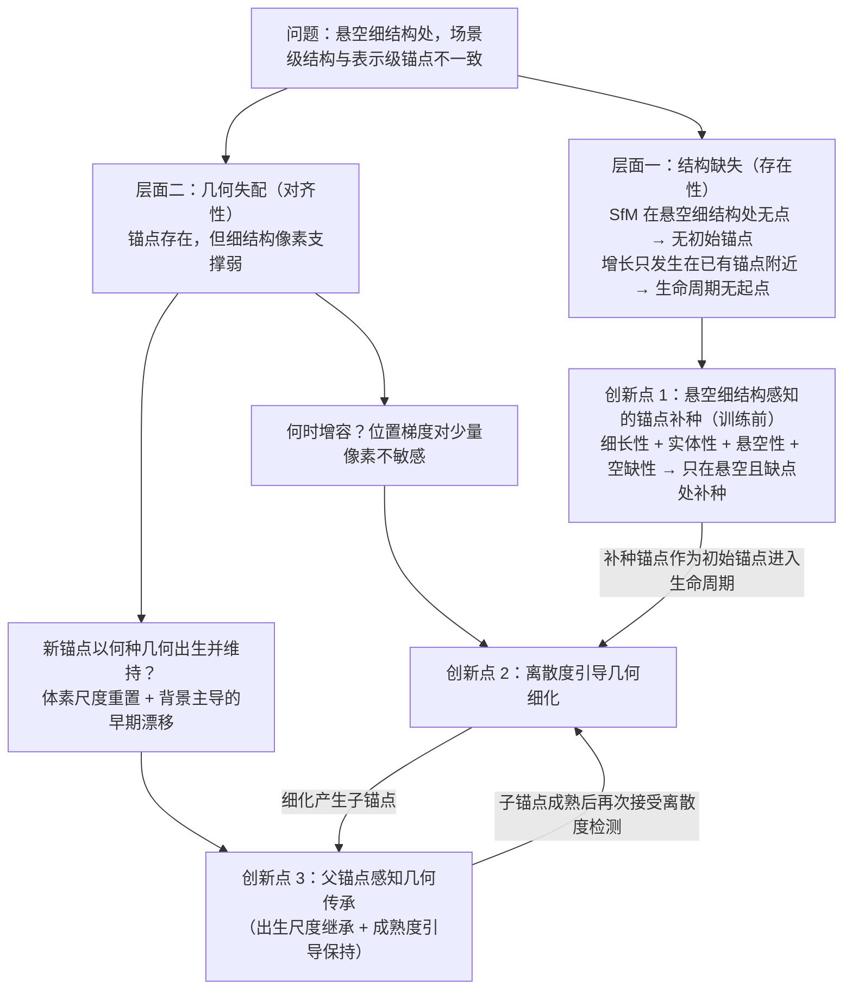

# 创新点重构方案与逻辑链（编辑稿，不属于投稿正文）

> 本文档基于 `paper_zh.md` 全文与 `init_points_zh.md`（初始点补充算法的详细版）整理。第 4 节给出可直接替换进主稿的精简文本；`init_points_zh.md` 保留为详细版，可作补充材料。
> 标注【待定】处需由训练实验确认；标注【核对】处需定稿前核实。

---

## 0 结论速览

**重构后的三个创新点**

| 编号 | 名称 | 回答的问题 | 来源 |
|---|---|---|---|
| 创新点 1 | **悬空细结构感知的锚点补种**（Anchor Seeding，AS） | 细结构处**有没有**锚点 | 新增 |
| 创新点 2 | **离散度引导几何细化**（GR） | **何时**为锚点增加容量 | 原 3.2，保持不变 |
| 创新点 3 | **父锚点感知几何传承**（GT） | 新增锚点**以何种几何出生、出生后如何不退化** | 原 3.3 GI + 原 3.4 GP 合并 |

**统一叙事**：沿锚点**全生命周期**形成“**补种—细化—传承**”闭环。补种决定生命周期能否在细结构处**开始**，细化与传承决定生命周期**进行中**几何是否与细结构对齐。

---

## 1 现稿论证主线的诊断

现稿主线：场景—高斯几何失配 → 以锚点生命周期为修正接口 → 三个失效阶段（细化触发、子锚点尺度初始化、出生后早期优化）→ GR、GI、GP 三个模块。

这条主线有一个**隐含前提：细结构处已经存在锚点**。三个模块都作用于已有锚点：GR 检测已有锚点内部的离散度，GI 继承父锚点的尺度，GP 保护已有锚点的尺度。但对悬空细结构而言，这个前提恰恰不成立：

1. SfM 在悬空细结构上几乎不产生点。这类结构缺少角点，沿结构方向外观重复，背景多为天空或远处表面。
2. Scaffold-GS 的锚点由 SfM 点体素化得到（式（1）），新锚点**只能在已有锚点所解码的神经高斯附近产生**。
3. 因此，这些区域的锚点生命周期**从未开始**，GR、GI、GP 都没有作用对象。

现稿在 2.1 末段已经提到“基于点的 SfM 对细长结构病态”（[20–22]），但只作为背景陈述，没有处理。**新创新点正好补上生命周期的“起点”这一环。它不是额外附加的预处理，而是现有论证链中逻辑上缺失的前提。** 这是新创新点能有机并入、而不显得生硬的根本依据。

---

## 2 三合二方案：GI + GP 合并为“父锚点感知几何传承”

**推荐合并 GI 与 GP，理由有四：**

1. **作用于同一变量**。二者都只作用于锚点基础尺度 $s_v$：GI 由式（11）给出出生尺度先验 $s_v^{\text{birth}}$，GP 由式（13）以 $s_v^{\text{birth}}$ 为参照约束 $s_v$。一个“给出”，一个“守住”，本来就是同一机制的两半。
2. **现稿已把二者写成前后衔接**。3.3 末句是“继承后的 $s_c$ 随即记录为子锚点的出生尺度先验，并由下一节的保持项……加以保护”。
3. **消融结果支持“二者是一个整体”**。单独加 GI 时，PSNR 提升 +0.06/+0.07/+0.07 dB；再加 GP 后又提升 +0.09/+0.10/+0.10 dB。现稿自己的解读是“继承尺度若在出生后得到适度保护，其作用能够更稳定地保留下来”。
4. **合并后的模块边界清晰**。GR 回答“何时增容”，依据是表示内部的几何分歧；GT 回答“新增容量的几何从哪来、如何维持”。两者问题不同、证据不同，不会重叠。

**不推荐合并 GR 与 GP**：二者只是共享成熟度 $c_v$，概念上分别是“触发”和“正则”，强行合并会显得牵强。共享的 $c_v$ 更适合作为连接创新点 2 与 3 的纽带来叙述（见第 3 节）。

---

## 3 新的逻辑链

### 3.1 总图

### 3.2 一句话版本

> 悬空细结构的失配同时存在于生命周期的**起点**（SfM 空缺导致**无锚点**）和**增长过程**（像素支撑不足导致**有锚点但不对齐**）。创新点 1 以多视图几何**识别**悬空细结构并补种锚点，使生命周期得以在此开始；创新点 2 判断补种锚点和已有锚点**何时**因同时拟合细前景与背景而需要细化；创新点 3 让细化产生的锚点**继承并保持**父锚点已学到的局部尺度。三者按“补种—细化—传承”首尾相接。

### 3.3 四处有机衔接（写作时应显式点出）

1. **分工互补：补种只需“粗定位”，对齐交给生命周期。**
   Scaffold-GS 的锚点特征初始化为零，锚点位置与偏移都可优化，所以补种点只需落在结构的若干个 $\epsilon$ 以内，无需精确重建曲线。反过来，GR 与 GT 也只有在补种提供起点之后，才能作用到悬空结构上。两部分互为前提，避免“预处理”和“训练模块”各说各话。这也解释了为什么补种不需要做曲线拟合、BA 这类精细重建。

2. **同一现象的两端：补种的“悬空性”与 GR 的“前景/背景不相容”。**
   悬空细结构的本质是前景深度显著小于其后方表面。补种在**场景层**用深度差识别它（式（6）中的悬空性条件）；补种锚点进入训练后，其解码高斯同时受细前景与远处背景监督，这正是 GR 在**表示层**用离散度检测的“不相容局部几何”。同一几何事实先在场景层被用来**放置锚点**，再在表示层被用来**细化锚点**。

3. **尺度衔接：补种锚点的初始尺度天然与结构尺度匹配，并受 GT 保护。**
   补种点以体素 $\epsilon$ 沿结构降采样，Scaffold-GS 按近邻锚点距离初始化基础尺度，所以补种锚点的初始尺度约为 $\epsilon$，而不会因孤立而偏大。现稿 3.4 已规定“对于初始锚点，该先验为初始基础尺度”，GT 的保持项因此**无需任何修改**就能在补种锚点成熟前保护这一尺度。（这是依据 Scaffold-GS 初始化机制的推理，需实验确认。）

4. **“跨层”含义更完整，标题可以保留。**
   原稿的“跨层”只指表示层内部与场景结构的几何一致性。加入补种后，“跨层”同时包含**从场景层到表示层的结构传递**（以场景的多视图几何证据创建锚点）和**表示层内部的几何维持**（GR + GT）。“基于跨层几何一致性的高斯泼溅细结构恢复”这个标题因此更名副其实。
   如需强调悬空结构，可选标题：“面向悬空细结构的跨层几何一致高斯泼溅”。

### 3.4 新创新点的核心定位（突出“针对性识别”）

和相关方法比，本文补种的区别**不在于**它用了哪种二维滤波或深度扫描，这些都是成熟技术，正文只需一两句带过并引用。区别**在于它回答了“哪里需要补点”**：

| 方法 | 重建对象 | 是否区分“悬空且 SfM 缺点”的结构 |
|---|---|---|
| LIMAP[21] | 场景中**全部**直线段 | 否：建筑边缘、窗框一并重建；下垂曲线被切成短段 |
| Vid2Curve / Slender3D | 由前景掩码给定的**单个物体**的曲线 | 否：需要语义掩码，并会重新估计位姿 |
| 放宽初始化的方法[22] | 降低对点式初始化的依赖 | 否：不针对缺点最严重的结构 |
| **本文 AS** | **只**在被识别为悬空、且原点云未覆盖的位置补点 | **是**：不依赖语义标注，以四个几何条件判定 |

正文应把**四条件判定**（式（6））作为该节的中心公式，其余步骤都是“为计算这四个条件服务”的实现。

---

## 4 可替换进主稿的文本

### 4.1 摘要（替换原摘要）

三维高斯泼溅（3D Gaussian Splatting，3DGS）能够实现实时、高质量的新视图合成，Scaffold-GS 等锚点式变体通过围绕锚点组织高斯，提高了表示的紧凑性和结构稳定性。然而，输电线、塔吊臂等悬空细结构仍难以恢复。一方面，这类结构缺少可匹配的纹理，运动恢复结构（SfM）几乎不在其上产生点，而锚点只能从已有锚点附近增长，导致其在训练全程缺少表示起点；另一方面，即使存在锚点，有限的像素支撑也会使高斯的尺度和方向与细结构几何失配。本文将二者统一视为场景级细结构与表示级锚点之间的跨层不一致，并沿锚点生命周期提出三个相互衔接的组成部分。**悬空细结构感知的锚点补种**在训练前以多视图几何识别“细长、多视图一致、悬于背景表面之前且未被 SfM 覆盖”的结构，并在其附近补充初始锚点；**离散度引导几何细化**识别同时拟合细前景与背景的锚点并对其细化；**父锚点感知几何传承**将父锚点已优化的基础尺度传递给新生锚点，并在其成熟前加以保持。三者构成“补种—细化—传承”的闭环。在多个包含丰富细结构的航拍场景上的实验表明，【待定：补种实验完成后填写结论】。

**关键词：** 新视图合成；三维高斯泼溅；锚点式表示；跨层几何一致性；悬空细结构；初始化

### 4.2 引言

**替换原第 3 段后半段**，即从“在 Scaffold-GS [2] 中，每个锚点均作为中间载体……”到段末：

在 Scaffold-GS [2] 中，每个锚点均作为中间载体，解码并管理一组局部高斯。然而，锚点支架只能修正已经存在的锚点。Scaffold-GS 的锚点由 SfM 点云体素化得到，并且只在已有锚点所解码的神经高斯附近增长；而悬空细结构缺少角点纹理、沿结构方向外观重复，背景又多为天空或远处表面，SfM 在其上几乎不产生点。因此，在这些区域，锚点生命周期从未开始，任何训练阶段的修正都无从作用。即使锚点存在，生命周期中仍有两处失效：细化由累计位置梯度触发，对仅占少量像素的细结构不敏感；新生锚点的基础尺度按体素层级重置，且出生后没有机制稳定该尺度。由此，细结构的失配表现为两个层面：生命周期起点处的**结构缺失**，以及增长过程中的**几何失配**。

**替换原第 4 段**：

因此，本文沿锚点生命周期处理场景级细结构与表示级几何之间的跨层不一致。在生命周期起点，**悬空细结构感知的锚点补种**在训练前固定 SfM 位姿，将多视图图像中的细长响应提升为三维候选，并以纯几何方式识别悬空细结构：要求候选被多个视角一致支持、深度显著小于其背后的已知表面、且位于 SfM 点云的空缺处，只在这些位置补充初始锚点。补种只需把锚点放到结构附近，精确对齐交由后续生命周期完成。**离散度引导几何细化**将锚点内较高的解码几何离散度视为其同时拟合细前景与背景的证据，并对其细化；**父锚点感知几何传承**在细化时将父锚点已优化的基础尺度传递给子锚点，并以基于可见性的成熟度在其优化早期保持该尺度。三者构成“补种—细化—传承”闭环：补种决定细结构处有无锚点，细化决定何时增加容量，传承决定新增锚点以何种几何出生并得以维持。

**替换贡献列表**：

本文的主要贡献如下：

1. 本文指出，锚点式 3DGS 在悬空细结构上的失败包含**结构缺失**与**几何失配**两个层面，并提出**悬空细结构感知的锚点补种**。该方法不依赖语义标注和外观匹配，以细长性、多视图实体性、悬空性和空缺性四个几何条件识别悬空细结构，在固定位姿下为其补充初始锚点，使锚点生命周期得以在 SfM 空缺处开始。
2. 本文提出**离散度引导几何细化**，以锚点内解码高斯的尺度与方向离散度作为其同时拟合不相容局部几何的证据，并以成熟度门控触发细化。
3. 本文提出**父锚点感知几何传承**，在细化时将父锚点已优化的基础尺度有界地传递给子锚点，并以同一成熟度调度在其优化早期保持该尺度。
4. 在多个包含丰富细结构的航拍场景上的实验验证了所提方法的有效性。

### 4.3 相关工作 2.1 末段（替换“初始化会进一步加剧该问题……”整段）

初始化会进一步加剧该问题。对于缺少角点纹理且仅跨越少量像素的细长结构，基于点的 SfM [20] 通常是病态的。线建图系统 [21] 能够重建场景中的直线段，但它重建的是全部直线结构，对与核面近似平行的线段存在退化，下垂曲线也需被切分为短段；面向细长物体的曲线重建方法 [31,32] 依赖前景掩码，并需重新估计相机位姿；放宽初始化要求的方法 [22] 降低了对点式初始化的依赖。这些方法均未回答“哪些细结构恰好是 SfM 的空缺”。本文的锚点补种不追求重建完整的线或曲线，而是只在被识别为悬空、且原点云未覆盖的位置补点，并与锚点式表示的增长机制直接衔接。

### 4.4 方法总述与预备知识

**替换方法总述第 1 段**（“本文通过 Scaffold-GS 的锚点接口处理跨层几何不一致……”）：

本文沿 Scaffold-GS 锚点的完整生命周期处理跨层几何不一致（图 2）。在训练开始前，悬空细结构感知的锚点补种（第 3.2 节）识别 SfM 未覆盖的悬空细结构，并在其附近补充初始锚点，使生命周期得以在这些区域开始。训练过程中，当一个锚点同时拟合细前景和邻近背景时，其解码高斯会面临相互冲突的尺度和方向需求；离散度引导几何细化（第 3.3 节）检测这种冲突并细化锚点。父锚点感知几何传承（第 3.4 节）随后将父锚点已优化的基础尺度传递给子锚点，并在其成熟前保护该尺度，避免几何被重置到体素粒度或被背景主导的更新破坏。三个组成部分形成“补种—细化—传承”闭环。

**“跨层”段（原第 2 段）末尾追加一句**：

对于悬空细结构，这种不一致还更早地表现为表示层中根本不存在对应锚点。因此，跨层一致性既包括从场景层向表示层传递结构的存在性，也包括表示层内部几何与场景结构的对齐。

**替换方法总述第 3 段末句**（“由此，三个模块分别回答……”）：

由此，三个模块分别回答“细结构处是否有锚点”“何时细化”以及“新增锚点以何种几何出生并如何避免退化”三个问题，并通过同一成熟度变量衔接为闭环。

**3.1 预备知识，在式（5）所在段末追加一句**：

此外，Scaffold-GS 的新锚点仅由已有锚点所解码神经高斯的中心 $\mu_v^i$ 经体素化产生，因此锚点所能覆盖的区域受初始点云 $P$ 的支撑范围限制：$P$ 中完全缺失的结构，在训练中也不会获得锚点。

### 4.5 新增 3.2 节（精简版，约 1,300 汉字）

> 以下公式编号接在主稿式（5）之后。插入后，原 3.2–3.4 节的式（6）—（14）依次顺延为（9）—（17）。

### 3.2 悬空细结构感知的锚点补种

式（1）只在 $P$ 有点的位置产生锚点，锚点增长又局限于已有锚点附近，因此 SfM 在细结构处的空缺会直接转化为表示中的永久空缺。悬空细结构恰是 SfM 失效最严重之处，但这种失效发生在对应关系阶段，而非几何阶段：背景区域保证了相机位姿可靠，细结构的三维位置仍可由多视图几何确定。本文据此在训练前固定 COLMAP 位姿，直接以几何条件识别悬空细结构，并只在其附近补充初始点。由于锚点特征初始化为零，位置与偏移均可优化，补充点只需落在结构的若干个体素尺度 $\epsilon$ 以内，精确对齐由后续生命周期模块完成。

**悬空细结构的几何判定。** 本文不依赖语义标注，而将悬空细结构刻画为同时满足四个几何条件的三维点：在图像中呈细长响应（细长性），被多个视角一致支持（实体性），位于其背后已知表面的前方（悬空性），且不被原始点云覆盖（空缺性）。前两者保证点真实位于细结构上，后两者把补种限定在锚点缺失的悬空区域。记参考视图 $r$ 中像素 $p$ 的视线为 $X_r(p,d)=C_r+d\,\mathbf{r}_r(p)$，其中 $C_r$ 为相机中心，$d$ 为相机坐标系深度。补充点集定义为

$$
P_{\text{thin}}=\Big\{X_r(p,d_p^{*})\ \Big|\ p\in\mathcal{C}_r,\ 
\underbrace{S_p(d_p^{*})\ge n_{\min}}_{\text{实体性}},\ 
\underbrace{d_p^{*}<\rho\,Z_r^{\text{bg}}(p)}_{\text{悬空性}},\ 
\underbrace{\operatorname{dist}\!\big(X_r(p,d_p^{*}),\,P\big)>\lambda_f\,\xi_p}_{\text{空缺性}}\Big\},
\tag{6}
$$

其中 $\mathcal{C}_r$ 为满足细长性的候选像素，$S_p$、$d_p^{*}$ 与 $Z_r^{\text{bg}}$ 由下文给出，$\rho<1$ 为前方比例，$\xi_p=d_p^{*}/f$ 为像素足迹（$f$ 为焦距），用于使距离阈值与场景尺度无关。每幅图像轮流作为参考视图。

**细长性与实体性。** 候选 $\mathcal{C}_j$ 由多尺度 Hessian 脊线响应 [33,34] 与小尺度亮斑响应给出，脊线响应经方向一致性的线积分连接断续线段，并预计算到同类候选的距离变换 $\mathcal{D}_j(\cdot)$。二维检测不区分语义，误检交由多视图几何剔除。实体性沿视线做固定位姿的深度扫描 [35]，以细结构距离变换代替光度代价，统计投影落在邻近视图 $\mathcal{N}(r)$ 中同类候选附近的视图数：

$$
S_p(d)=\sum_{j\in\mathcal{N}(r)} v_j(d)\;\mathbb{1}\!\left[\mathcal{D}_j\!\big(\pi_j(X_r(p,d))\big)\le\delta\right],
\qquad
d_p^{*}=\arg\max_{d}\,S_p(d),
\tag{7}
$$

其中 $\pi_j$ 为视图 $j$ 的投影，$\delta$ 为像素容差，有效指示 $v_j(d)$ 剔除两类无信息视图：细线与核线近似平行的退化视图 [21]，以及样本位于该视图已知表面之后的遮挡视图。除支持数外，$d_p^{*}$ 还须在有效视图中占多数且沿视线唯一，以排除平行导线、重复灯泡造成的多重解。该过程以细结构几何而非外观建立对应，因而不受天空等无纹理背景影响，其几何含义与曲线重投影对齐 [31,32] 一致。

**悬空性。** 悬空性是区分悬空细结构与表面纹理边缘的关键：二者都满足细长性与实体性，但悬空结构的深度显著小于同一视线后方的表面，而表面边缘的深度与之近似相等。本文将 $P$ 投影到各视图，以像素 $x$ 所在 $b\times b$ 图块 $\mathcal{T}(x)$ 内点深度 $z_j(\cdot)$ 的低分位数作为背景深度：

$$
Z_j^{\text{bg}}(x)=Q_{q}\Big(\big\{\,z_j(X)\ \big|\ X\in P,\ \pi_j(X)\in\mathcal{T}(x)\big\}\Big).
\tag{8}
$$

点数不足的图块（天空、未重建区域）记为 $+\infty$，不施加约束；采用低分位数而非最小值，是为了避免少量错误 SfM 点压缩其前方的自由空间。悬空判据作用于扫描得到的最优深度：扫描始终在完整深度区间上进行，最优解不在背景前方即丢弃该候选。若改为把扫描截断在背景之前，真实深度位于表面上的候选会被迫取得表面前方的次优解，反而制造悬浮伪点。【待定：若消融支持单目深度补全，在此加一句“对于 $P$ 中无点的弱纹理表面，可用按 SfM 点对齐尺度的单目深度 [36] 补全 $Z_j^{\text{bg}}$”；否则删去此句及文献 [36]。】

**空缺性与输出。** 空缺性条件保证补种只发生在原点云未覆盖处，避免在已有锚点的区域重复加点。此外，每个点还须在半径 $\lambda_s\xi_p$ 内被至少 $n_r$ 个其他参考视图的结果印证，以剔除单视图的偶然对齐。最终以体素 $\epsilon$ 对 $P_{\text{thin}}$ 降采样，并以 $P'=P\cup P_{\text{thin}}$ 代替式（1）中的 $P$。补种锚点作为初始锚点进入后续生命周期：其成熟度按式（12）从零开始累积，成熟前受第 3.4 节保持项约束；成熟后若同时拟合细前景与背景，则由第 3.3 节的离散度检测触发细化。

### 4.6 合并后的 3.4 节：父锚点感知几何传承

**结构**：

- 3.4 父锚点感知几何传承（新的开头段，见下）
  - **3.4.1 出生尺度继承**：原 3.3 节，公式不变（顺延为式（14）—（15））
  - **3.4.2 成熟度引导尺度保持**：原 3.4 节，公式不变（顺延为式（16）—（17））

**3.4 开头段（新写）**：

细化决定何时增加表示容量，但不决定新增锚点以何种几何出生。父锚点感知几何传承处理子锚点基础尺度 $s_v$ 从出生到成熟的全过程：出生时由父锚点继承（第 3.4.1 节），成熟前加以保持（第 3.4.2 节）。两部分作用于同一变量：继承给出出生尺度先验 $s_v^{\text{birth}}$，保持以其为参照约束早期漂移，共同构成“给出—守住”的整体。只有继承而无保持，继承的尺度会在背景主导的早期更新中丢失；只有保持而无保持对象的合理初始化，被保持的只是与局部结构无关的体素尺度。

**3.4.2 中对初始锚点的表述改为**：“对于初始锚点（包括第 3.2 节的补种锚点），该先验为其初始基础尺度。”

**为抵消新增篇幅的建议删减**（约 400–500 汉字）：

- 原 3.3 第 4、5 段（“分裂与克隆对应两种不同的容量调整需求……”“逐元素最小值还保留了尺度的轴向差异……”），可各压缩为一句；
- 原 3.2 第 3 段（“组合权重 $\lambda_r$ 与 $\lambda_q$……”），可压缩为一句；
- 方法总述第 3 段与 3.1 中重复说明“两级参数关系”的内容，可删去一处。

### 4.7 实验部分的调整

**消融表（可复用现有数据，只需补跑两组）**：

| 变体 | 含义 | 数据来源 |
|---|---|---|
| Scaffold-GS | 基线 | 现有表 3 第 1 行 |
| + GT | 传承（GI+GP） | 现有表 3 第 3 行 |
| + GT + GR | 原完整模型 | 现有表 3 第 4 行 |
| + AS | 仅补种 | **待跑** |
| **+ AS + GR + GT（完整模型）** | 新完整模型 | **待跑** |

- 模块内部消融放在正文或补充材料：
  - GT 内部：GI 单独 vs. GI+GP，直接用现有表 3 第 2、3 行；
  - **AS 内部（用于突出“悬空识别”这一核心创新，建议必做）**：AS 去掉悬空性 / 去掉空缺性 / 完整 AS。报告整图指标、细结构区域指标（rPSNR/rSSIM/rLPIPS）和补种点数。
- **表 1、表 2 中“本文方法”一行需换成新完整模型的结果**。现有数值是在没有补种的情况下得到的。
- **建议新增一张补种可视化图**：在一个测试视角上，对比原始 SfM 点投影与补种点投影。可用 Rubble `000049` 的电线和电线杆区域，现成的图是 `rubble200/thin_init/preview/reproj_000049_crop.png`。
- 实现细节中补充：补种的运行时间（全部在 CPU 上；Rubble 子集 198 幅、1147×860 约 22 min），以及补种点数占原点云的比例。
- UrbanAerial3D 与 Building 需在训练所用分辨率下各运行一次补种。

### 4.8 结论（追加）

在原结论“本文处理了锚点式 3DGS 中的跨层几何不一致问题”之后补充：

本文进一步指出，对于悬空细结构，这种不一致首先表现为 SfM 空缺导致的锚点缺失，并通过以几何条件识别悬空细结构的锚点补种，使锚点生命周期得以在这些区域开始。

局限部分补充：补种依赖二维细长响应与成像几何。投影宽度小于约一个像素的细线、以及所有视图对中细线均与核线近似平行的采集方式（例如航线与输电线走向一致），仍难以获得补种点。

### 4.9 图 2 修改建议

在现有“检测—传递—保持”循环图左侧增加一个训练前阶段：“多视图图像 + SfM 点云 → 悬空细结构识别（四条件）→ 补种锚点”，并用箭头接入锚点生命周期循环。循环本身改为三段：“补种 → 细化（GR）→ 传承（GT：继承 + 保持）→ 成熟后再次细化”。

### 4.10 需要新增的参考文献

| 编号 | 文献 | 状态 |
|---|---|---|
| [31] | WANG P, LIU L, CHEN N, et al. Vid2Curve: Simultaneous camera motion estimation and thin structure reconstruction from an RGB video. *ACM Transactions on Graphics*, 2020, 39(4). | 【核对】卷期页码 |
| [32] | Slender3D（AAAI 2026，DOI: 10.1609/aaai.v40i12.37979） | 【核对】作者与页码 |
| [33] | FRANGI A F, NIESSEN W J, VINCKEN K L, et al. Multiscale vessel enhancement filtering. In: *MICCAI*, 1998: 130–137. | |
| [34] | STEGER C. An unbiased detector of curvilinear structures. *IEEE TPAMI*, 1998, 20(2): 113–125. | |
| [35] | COLLINS R T. A space-sweep approach to true multi-image matching. In: *CVPR*, 1996: 358–363. | |
| [36] | YANG L, KANG B, HUANG Z, et al. Depth Anything V2. In: *NeurIPS*, 2024. | 【待定】仅当保留单目补全时引用 |

---

## 5 篇幅影响（估算）

| 部分 | 变化 |
|---|---|
| 摘要 | 约 +40 汉字（接近 30% 提醒阈值，可删去背景句压缩） |
| 引言 | 约 +150 汉字（原稿已偏长 42.9%，建议同时压缩引言中对各模块实现的展开） |
| 相关工作 | 约 +80 汉字 |
| 方法 | 新增 3.2 节约 1,300 汉字；按 4.6 删减约 400–500 汉字；净增约 800–900 汉字，方法部分约 4,900 汉字 |
| 实验 | 视补跑结果而定，约 +200 汉字 |

---

## 6 风险与待办

1. **补种的收益尚无训练结果**。目前只有 Truck 和 Rubble 上的代理指标（补种点数、灯带覆盖率、重投影图）。第 4 节中所有关于效果的表述，都要等新完整模型和 AS 消融跑完再写。
2. **单目补全是否保留【待定】**。按之前在 Truck 上的分析，单目补全以召回为代价提高悬空纯度，可能是负向的。建议正文默认只写 SfM 背景深度（式（8）），单目补全仅在消融证明有益时加入。
3. **补种锚点的早期剪枝**。GT 的保持项只约束尺度，不保护不透明度。如果实验中发现补种锚点在第一次剪枝时被大量删除，可以用同一成熟度 $c_v$ 推迟其剪枝（需要实现）。这样做还能进一步加强补种与生命周期的耦合，叙述上也更自然。
4. **新颖性表述的边界**。“以四个几何条件识别悬空细结构”这一点，在此前有限的文献检索中没有找到相同做法，但检索范围有限，投稿前建议再查摄影测量和遥感期刊（ISPRS、TGRS 等）中关于电力线三维重建的工作。
5. **代码版本**。正文描述对应 `point_cloud_init/` 当前实现。若最终配置改为 `--bg colmap`，需同步修改 4.5 节中的【待定】句。
